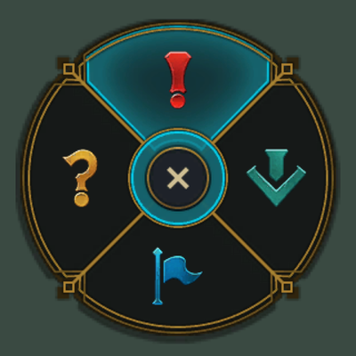
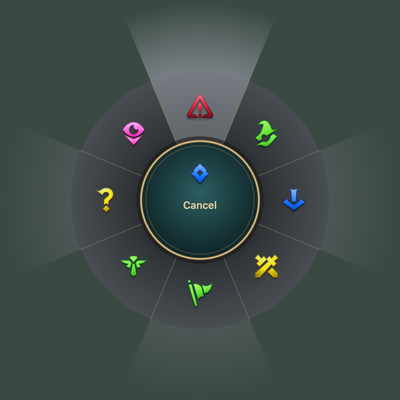

<div align="center">


# ping-signals

**把英雄联盟的标记轮盘搬到你的 Mac 桌面上，而且每个信号都会真的做点事。**

按住 <kbd>⌥</kbd> 拖一下，召唤轮盘；松手，信号落地。

[](#安装)
[](https://swift.org)
[](#性能)
[](LICENSE)
[](#性能)

[English](README_EN.md) · **简体中文**


</div>

---

## ✨ 为什么做这个

[lolPing](https://github.com/darrenprx/lolPing) 把召唤师峡谷的标记带到了桌面，很好玩，但它是 Electron 写的：常驻约 **490 MB** 内存，空闲时还占 7–12% CPU，安装包 175 MB。

ping-signals 用纯 Swift 重写，只保留标记本身，再让标记变成**信号**：问号就只是一个问号，但「请求协助」会叫来 Claude，「危险」会帮你瞬间撤退到干净的桌面。

## 🎯 信号一览

| 标记 | 方向（经典） | 触发的动作 |
|:---:|:---:|---|
| ❗ **危险** | ↑ | **撤退**：一键隐藏所有窗口，只剩壁纸、Dock 和菜单栏。再打一次危险，一切原样回来 |
| ⬇️ **正在路上** | → | **待办面板**：从屏幕右侧滑出，立刻可以输入。自动记下当时所在的应用、窗口标题和网页地址，点一下就能跳回去 |
| 🚩 **请求协助** | ↓ | **呼叫 Claude**：打开 Claude 桌面版的快速输入框 |
| ❓ **敌人消失** | ← | 什么都不做，就是一个单纯的问号 |
| 📍 **普通标记** | <kbd>⌥</kbd> + 单击 | 只有动画和音效 |

> 菜单栏里的预览永远不会触发动作，可以放心点着玩。

## 🕹️ 两套轮盘

<table>
<tr>
<td align="center" width="50%">
<br>
<b>经典（2022 前）· 默认</b><br>
<sub>4 格，熟悉的味道，原版 12.21 贴图与音效</sub>
</td>
<td align="center" width="50%">
<br>
<b>新版</b><br>
<sub>8 格：推进、全力进攻、需要视野、诱饵……</sub>
</td>
</tr>
</table>

## ⚡ 性能

同样是一个常驻菜单栏的标记工具：

| | lolPing（Electron） | **ping-signals** |
|---|---:|---:|
| 内存占用 | ~490 MB | **~40 MB** |
| 空闲 CPU | 7–12% | **0.03%** |
| 应用体积 | 343 MB | **2.5 MB** |

<sub>M1 Pro / macOS，用 `scripts/measure.sh` 测量。</sub>

省下来的地方：不监听普通鼠标移动（只在按住触发键时才有事件），浮层窗口只在用的时候才出现，音频引擎单独排队，贴图按需裁剪。

## 🧠 贴心细节

- **全屏游戏里自动让路**：前台是全屏游戏（比如真的在打 LoL）时，<kbd>⌥</kbd> + 点击原样放行；全屏的浏览器、视频、编辑器里照样能打标记。
- **不吞你的点击**：<kbd>⌥</kbd> + 单击没拖动，会把原来的点击原样补发给下面的应用。
- **随时暂停**：<kbd>⌃</kbd><kbd>⌥</kbd><kbd>P</kbd> 暂停 / 恢复，菜单栏图标会变灰。
- **多屏友好**：撤退时每块屏幕都铺上它自己的壁纸。
- **权限被收回也不怕**：辅助功能权限被撤销或事件监听被系统停掉，会自动发现并恢复。

## 📦 安装

> 还没有发布正式版本，目前需要从源码构建。

需要 macOS 14+、Xcode 16+ 和 [XcodeGen](https://github.com/yonaskolb/XcodeGen)。

```bash
git clone https://github.com/muxia23/ping-signals.git
cd ping-signals
brew install xcodegen

scripts/make-cert.sh        # 只需一次：创建本地签名证书，重新构建后不用重新授权
xcodegen generate
xcodebuild build -project PingSignals.xcodeproj -scheme PingSignals \
  -configuration Release -derivedDataPath build -quiet

open build/Build/Products/Release/ping-signals.app
```

首次启动时按提示授予**辅助功能**权限（用来监听 <kbd>⌥</kbd> + 拖动）。「正在路上」第一次读取浏览器网址时，系统会请求**自动化**权限，拒绝也不影响保存待办。

## 🏗️ 项目结构

```
Core/      PingCore：纯逻辑（手势状态机、轮盘几何、标记目录、信号总线、待办存储、撤退计划）
App/       系统交互（事件监听、浮层、轮盘绘制、动画、音频、菜单栏、各个动作）
Tests/     Swift Testing 单元测试
scripts/   签名证书、素材导入、性能测量
docs/      设计文档与实现计划
```

所有能脱离系统运行的逻辑都在 `PingCore` 里，并有单元测试：

```bash
xcodebuild test -project PingSignals.xcodeproj -scheme PingSignals \
  -destination 'platform=macOS,arch=arm64' -derivedDataPath build
```

## 🗺️ 路线图

- [x] 经典 / 新版两套轮盘，动画与音效
- [x] 信号动作：撤退、待办面板、呼叫 Claude
- [ ] 设置窗口：触发键、拖动阈值、新版轮盘自定义、暂停快捷键录制
- [ ] 首次引导、开机自启
- [ ] 中英文界面
- [ ] 自动更新（Sparkle）与正式发布
- [ ] 更多信号：「问号」记录下当时的疑问……

## 🙏 致谢

- [darrenprx/lolPing](https://github.com/darrenprx/lolPing)：本项目的灵感来源，手势逻辑移植自它（MIT）。
- [CommunityDragon](https://communitydragon.org)：经典 12.21 轮盘素材的存档。

## 📄 许可证

代码以 [MIT](LICENSE) 协议开源。

ping-signals 不受 Riot Games 认可，也不代表 Riot Games 或任何参与制作或管理《英雄联盟》的人员的观点或意见。《英雄联盟》及 Riot Games 是 Riot Games, Inc. 的商标或注册商标。标记贴图与音效版权归 Riot Games, Inc. 所有。

<div align="center">
<sub>如果它让你会心一笑，点个 ⭐ 吧。</sub>
</div>
