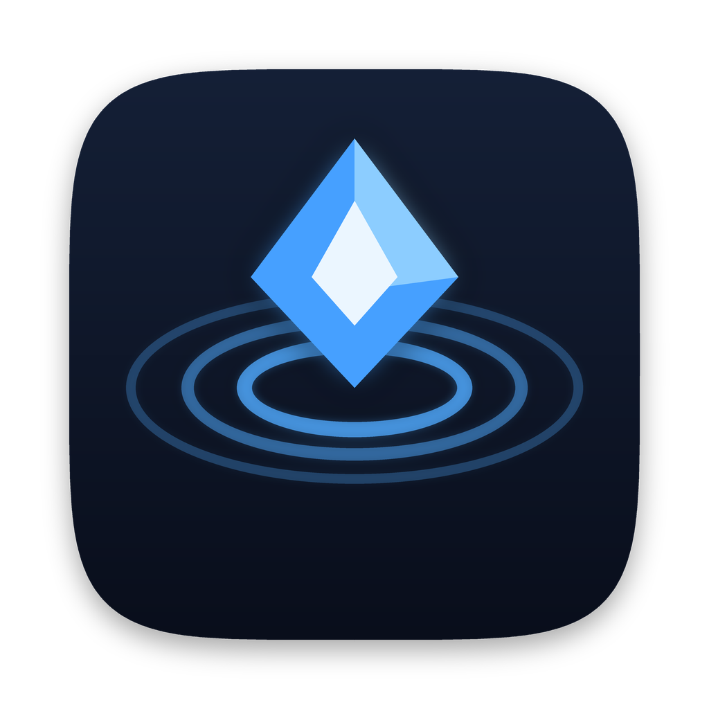
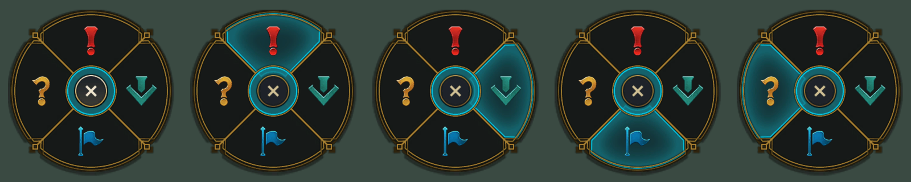
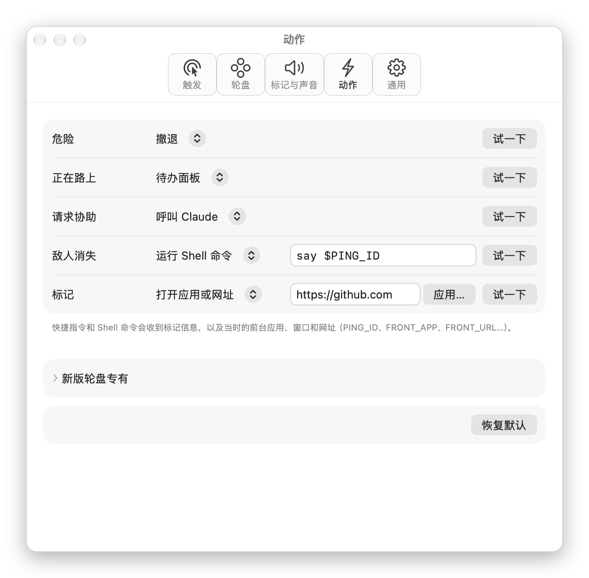
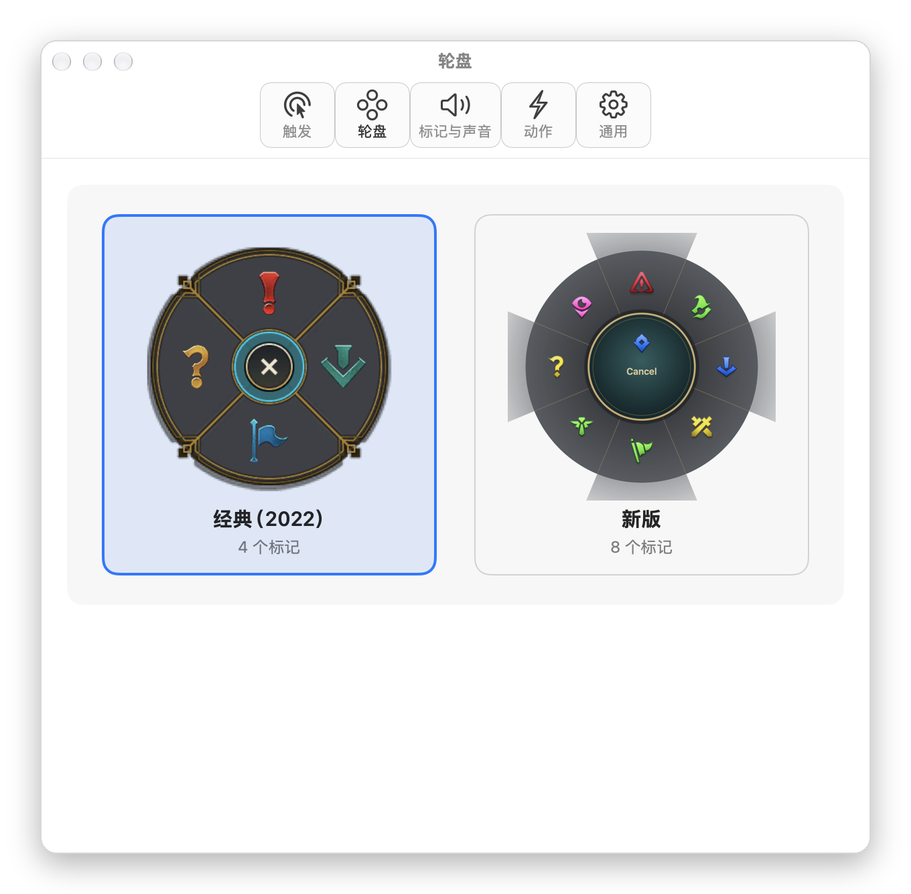

<div align="center">



# ping-signals

### 把召唤师峡谷的信号，带到你的 Mac 桌面。

按住 <kbd>⌥</kbd> 拖一下召唤轮盘，松手放出信号。每个信号都会替你做一件事。

[](#-安装)
[](https://swift.org)
[](#-轻到感觉不到)
[](https://github.com/muxia23/ping-signals/releases/latest)
[](LICENSE)

**简体中文** · [English](README_EN.md)

<br>



</div>

<br>

<table>
<tr>
<td width="33%" valign="top">

#### 🎯 信号，不只是表情
「危险」一键撤退到干净桌面，「正在路上」滑出待办，「请求协助」叫来 Claude。

</td>
<td width="33%" valign="top">

#### 🧩 每个信号都能自定义
运行快捷指令、按快捷键、打开应用或网址、跑一行 Shell。11 种标记，任你绑定。

</td>
<td width="33%" valign="top">

#### 🪶 轻到感觉不到
纯 Swift 原生实现。空闲时约 25 MB 内存、CPU 不到 0.2%，安装包不到 3 MB。

</td>
</tr>
</table>

---

## 🎯 开箱即用的信号

| | 标记 | 经典方向 | 默认动作 |
|:---:|---|:---:|---|
| ❗ | **危险** | ↑ | **撤退**：隐藏所有窗口，只留壁纸、Dock 和菜单栏。再打一次，一切原样回来 |
| ⬇️ | **正在路上** | → | **待办面板**：从屏幕右侧滑出，直接输入。自动记下当时的应用、窗口标题和网页，点一下跳回去；可设优先级和截止时间，到点提醒 |
| 🚩 | **请求协助** | ↓ | **呼叫 Claude**：打开 Claude 桌面版的快速输入框 |
| ❓ | **敌人消失** | ← | 不做任何事，它就是一个问号 |
| 📍 | **标记** | <kbd>⌥</kbd> + 单击 | 只有动画和音效 |

> 这些只是默认值。每个信号做什么，都可以在设置里改。

## ✅ 待办面板

打「正在路上」，待办面板从右侧滑出。每条待办记下你当时在看的应用、窗口和网页，点一下就能回去。

- **优先级**：高 / 中 / 低，左侧色条一眼可见；列表按优先级、再按截止时间排序
- **截止时间**：今天 / 明天 / 下周一一键选，或在日历里挑，可加具体时间；逾期标红、当天标橙
- **到点提醒**：有时间的到点提醒，只有日期的当天 9:00 提醒，点通知直接打开面板
- **快捷写法**：`交报告 !高 @周五18:00`，回车即存（`!高 !中 !低`、`@今天 @明天 @后天 @周一…周日 @下周 @10-20 @18:00`）

## 🧩 自定义动作

<div align="center">

</div>

每种标记可以绑定下面任意一种动作，旁边的「试一下」能立刻验证：

| 动作 | 你需要提供 |
|---|---|
| 撤退 · 待办面板 · 呼叫 Claude | 无，内置 |
| **呼唤 ChatGPT · 呼唤 Codex** | 无，内置；在动作下拉菜单中选择 |
| **运行快捷指令** | 从你的「快捷指令」列表里选一条 |
| **按快捷键** | 录制一个组合键，比如唤出 Raycast、截图 |
| **打开应用或网址** | 一个网址、`xxx://` 链接，或直接选一个应用 |
| **运行 Shell 命令** | 一行命令，用 `zsh -l` 执行 |

在 **设置 → 动作** 里，可以把任意信号绑定到「呼唤 ChatGPT」或「呼唤 Codex」。「请求协助」默认仍是呼叫 Claude，已保存的自定义绑定不受影响。

两个动作都优先打开桌面版，分别兼容 ChatGPT Classic 和独立的 Codex 应用。找不到合适的应用或 macOS 报告启动失败时，分别打开 [ChatGPT](https://chatgpt.com/) 或 [Codex](https://chatgpt.com/codex) 网页版。桌面版能否直接进入对应模式取决于应用版本。两个动作都不需要 API Key，不读取剪贴板，不传当前应用的上下文，也不会自动发消息或执行任务。

<details>
<summary><b>快捷指令和 Shell 能拿到的上下文</b></summary>

<br>

Shell 命令以环境变量接收，快捷指令以 JSON 输入接收。拿不到的值会被省略。

| 环境变量 | JSON 键 | 内容 |
|---|---|---|
| `PING_ID` | `ping` | 标记 ID，如 `danger`、`missing` |
| `PING_STYLE` | `style` | `classic` / `modern` |
| `PING_X` / `PING_Y` | `x` / `y` | 打标记的位置（全局坐标） |
| `FRONT_APP` | `app` | 前台应用名称 |
| `FRONT_BUNDLE_ID` | `bundleID` | 前台应用 bundle id |
| `WINDOW_TITLE` | `windowTitle` | 前台窗口标题 |
| `FRONT_URL` | `url` | 浏览器当前网址（Safari / Chrome / Arc / Edge / Brave） |

</details>

<details>
<summary><b>几个配方</b></summary>

<br>

**问号 → 把疑问记下来**

```sh
echo "- $(date '+%F %T') $FRONT_APP · $WINDOW_TITLE $FRONT_URL" >> ~/Documents/questions.md
```

**问号 → 念出来**（试试手感）

```sh
say "$PING_ID"
```

**全力进攻 → 进入专注**：「运行快捷指令」，选一条打开专注模式的快捷指令。

**需要视野 → 截图**：「按快捷键」，录制 <kbd>⌘</kbd><kbd>⇧</kbd><kbd>4</kbd>。

</details>

## 🕹️ 两套轮盘

<div align="center">

</div>

**经典（2022 前）**是默认：4 格，原汁原味的 12.21 贴图与音效。**新版**有 8 格：推进、全力进攻、需要视野、诱饵……在设置里点一下图片就能切换。

## 🪶 轻到感觉不到

同样是常驻菜单栏的标记工具：

| | lolPing（Electron） | **ping-signals** |
|---|---:|---:|
| 内存占用（空闲） | ~490 MB | **~25 MB** |
| 空闲 CPU | 7–12% | **< 0.2%** |
| 安装包 | 175 MB | **2.7 MB** |

<sub>M1 Pro，`scripts/measure.sh` 测量。</sub>

秘诀很朴素：不监听普通的鼠标移动，只在按住触发键时才处理事件；浮层窗口用到时才分配显存；设置窗口关掉就释放；贴图只保留画得到的像素。放过标记、开过设置后常驻约 80–100 MB（轮盘贴图缓存，保证轮盘瞬间弹出），不会继续增长。

## ✨ 细节

- **全屏游戏里自动让路**：前台是全屏游戏时，<kbd>⌥</kbd> + 点击原样放行；全屏的浏览器、视频、编辑器照样能打标记。
- **不吞你的点击**：<kbd>⌥</kbd> + 单击没拖动，原来的点击会补发给下面的应用。
- **随时暂停**：默认 <kbd>⌃</kbd><kbd>⌥</kbd><kbd>P</kbd>，可以在设置里重新录制。
- **都能改**：触发键（⌥ / ⌃ / ⇧ / ⌘ / 鼠标侧键 / 任意按键）、拖动距离、标记大小与时长、音量。
- **多屏友好**：撤退时每块屏幕铺上它自己的壁纸。
- **权限被收回也不怕**：辅助功能权限被撤销或事件监听被系统停掉，会自动发现并恢复。
- **中英双语**，开机自启，首次启动有引导。

## 🔒 隐私

ping-signals 不联网，也不记录你的输入。「辅助功能」权限只用来识别触发键和鼠标手势；「自动化」权限只在需要时读取浏览器当前网址，拒绝也不影响使用。

## 📦 安装

1. 从 [Releases](https://github.com/muxia23/ping-signals/releases/latest) 下载 `ping-signals-x.y.z.dmg`（Apple 芯片与 Intel 通用，需要 macOS 14+）。
2. 打开 dmg，把 **ping-signals** 拖进「应用程序」。
3. 第一次打开：ping-signals 没有经过 Apple 公证，macOS 会拦一下。到 **系统设置 → 隐私与安全性**，在底部点 **「仍要打开」**。或者在终端运行：
   ```bash
   xattr -dr com.apple.quarantine /Applications/ping-signals.app
   ```
4. 按引导窗口打开「辅助功能」权限，窗口会自己关掉。菜单栏出现图标即可开始：按住 <kbd>⌥</kbd> 拖一下。

<details>
<summary><b>从源码构建</b></summary>

<br>

需要 Xcode 16+。

```bash
git clone https://github.com/muxia23/ping-signals.git
cd ping-signals
brew install xcodegen

scripts/make-cert.sh        # 只需一次：创建本地签名证书，重新构建后不用重新授权
xcodegen generate
xcodebuild build -project PingSignals.xcodeproj -scheme PingSignals \
  -configuration Release -derivedDataPath build -quiet

open build/Build/Products/Release/ping-signals.app
```

</details>

<details>
<summary><b>开发者</b></summary>

<br>

```
Core/      PingCore：纯逻辑（手势状态机、轮盘几何、标记目录、动作配置、信号总线、待办、撤退）
App/       系统交互（事件监听、浮层、轮盘绘制、动画、音频、菜单栏、动作执行、设置窗口）
Tests/     Swift Testing 单元测试
scripts/   签名证书、素材导入、图标绘制、性能测量
docs/      设计文档与实现计划
```

```bash
# 测试
xcodebuild test -project PingSignals.xcodeproj -scheme PingSignals \
  -destination 'platform=macOS,arch=arm64' -derivedDataPath build

# 导出轮盘 / 设置窗口预览图
ping-signals.app/Contents/MacOS/ping-signals --render-wheels <dir>
ping-signals.app/Contents/MacOS/ping-signals --render-settings <dir>
```

</details>

## 🗺️ 路线图

- [x] 经典 / 新版两套轮盘，动画与音效
- [x] 信号动作：撤退、待办面板、呼叫 Claude
- [x] 自定义动作：快捷指令、快捷键、应用 / 网址、Shell
- [x] 设置窗口、首次引导、开机自启、中英双语
- [x] 首个正式版本 v0.1.0
- [x] 待办：优先级、截止时间、快捷写法、到期提醒

## 🙏 致谢

- [darrenprx/lolPing](https://github.com/darrenprx/lolPing)：本项目的灵感来源，手势逻辑移植自它（MIT）。
- [CommunityDragon](https://communitydragon.org)：经典 12.21 轮盘素材的存档。

## 📄 许可证

代码以 [MIT](LICENSE) 协议开源。

ping-signals 不受 Riot Games 认可，也不代表 Riot Games 或任何参与制作或管理《英雄联盟》的人员的观点或意见。《英雄联盟》及 Riot Games 是 Riot Games, Inc. 的商标或注册商标。标记贴图与音效版权归 Riot Games, Inc. 所有。

<br>

<div align="center">

<br>
<sub>如果它让你会心一笑，点个 ⭐ 吧。</sub>
</div>
