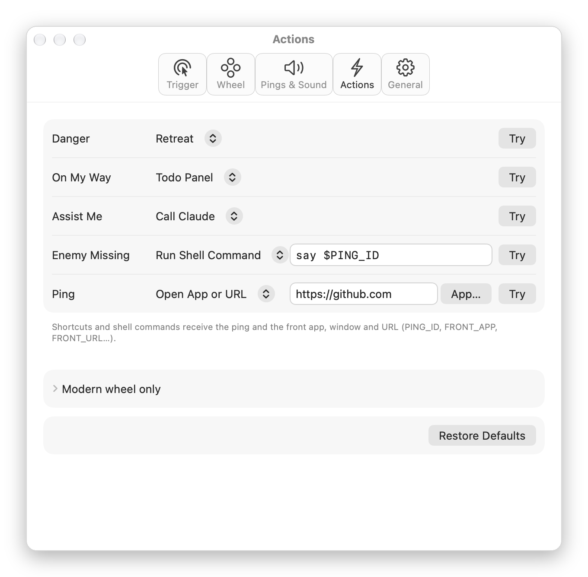
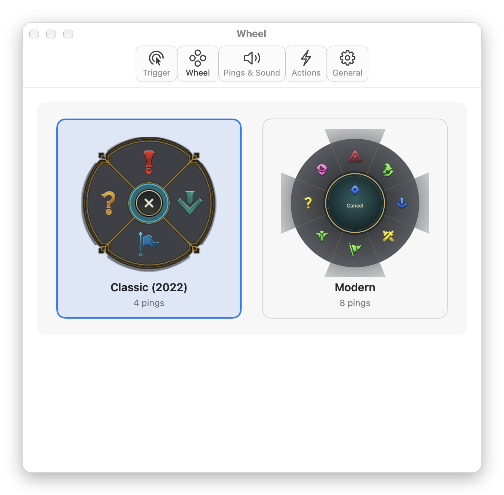

<div align="center">


# ping-signals

### Summoner's Rift pings, on your Mac desktop.

Hold <kbd>⌥</kbd> and drag to summon the wheel. Let go to send a signal. Every signal does something for you.

[](#-install)
[](https://swift.org)
[](#-featherweight)
[](https://github.com/muxia23/ping-signals/releases/latest)
[](LICENSE)

**English** · [简体中文](README.md)

<br>


</div>

<br>

<table>
<tr>
<td width="33%" valign="top">

#### 🎯 Signals, not emotes
Danger retreats to a clean desktop. On My Way slides in a todo list. Assist Me calls ChatGPT.

</td>
<td width="33%" valign="top">

#### 🧩 Make every ping yours
Run a shortcut, press keys, open an app or URL, or run a shell command. 11 pings, bind them as you like.

</td>
<td width="33%" valign="top">

#### 🪶 Featherweight
Native Swift. About 25 MB of memory and under 0.2% CPU at idle, and a download under 3 MB.

</td>
</tr>
</table>

---

## 🎯 Signals out of the box

| | Ping | Classic direction | Default action |
|:---:|---|:---:|---|
| ❗ | **Danger** | ↑ | **Retreat**: hides every window, leaving the wallpaper, Dock and menu bar. Ping again and everything comes back |
| ⬇️ | **On My Way** | → | **Todo panel**: slides in from the right, ready to type. Records the app, window title and web page you were on; click to jump back. Priorities, due dates and reminders |
| 🚩 | **Assist Me** | ↓ | **Call ChatGPT**: opens the ChatGPT desktop app, or the web app if unavailable |
| ❓ | **Enemy Missing** | ← | Nothing. It's just a question mark |
| 📍 | **Ping** | <kbd>⌥</kbd> + click | Animation and sound only |

> These are just defaults. What each signal does is up to you in Settings.

**Call ChatGPT** opens a new chat in ChatGPT mode in the current desktop app, or activates the main window in ChatGPT Classic. If the desktop app is missing or fails to launch, it opens `https://chatgpt.com/`. No API key is needed; no clipboard content is read and no message is sent automatically. It does not simulate a global keyboard shortcut that the user may have remapped.

**Call Codex** is a separate choice in each action menu. It opens the new-task screen in Codex mode in the unified ChatGPT desktop app, or activates standalone Codex. If the desktop app is missing or fails to launch, it opens `https://chatgpt.com/codex`. It does not send a message or start work automatically. Assist Me still defaults to ChatGPT; bind Codex to another ping to keep both available.

Existing action bindings are preserved on upgrade. To change an existing Claude binding, choose **Settings → Actions → Assist Me → Call ChatGPT**, then click **Try**. Other pings are unchanged.

## ✅ Todo panel

Ping On My Way and the todo panel slides in from the right. Each todo remembers the app, window and web page you were on; click to go back.

- **Priority**: high / medium / low, shown as a colour bar; the list sorts by priority, then due date
- **Due dates**: today / tomorrow / next Monday in one click, or pick from a calendar, optionally with a time; overdue turns red, due today orange
- **Reminders**: a notification at the due time, or 9:00 on the day for date-only todos; clicking it opens the panel
- **Quick syntax**: `Send report !high @fri18:00` and Return (`!high !med !low`, `@today @tomorrow @mon…@sun @nextweek @10-20 @18:00`)

## 🧩 Custom actions

<div align="center">

</div>

Bind any ping to any of these, and check it right away with **Try**:

| Action | What you provide |
|---|---|
| Retreat · Todo Panel · Call ChatGPT · Call Codex · Call Claude | Nothing, built in |
| **Run Shortcut** | One of your Shortcuts |
| **Press Keys** | A recorded key combination, e.g. to summon Raycast or take a screenshot |
| **Open App or URL** | A web address, any `scheme://` link, or an app you pick |
| **Run Shell Command** | One command line, run with `zsh -l` |

<details>
<summary><b>Context passed to shortcuts and shell commands</b></summary>

<br>

Shell commands get environment variables; shortcuts get JSON input. Values that aren't available are left out.

| Variable | JSON key | Contents |
|---|---|---|
| `PING_ID` | `ping` | Ping ID, e.g. `danger`, `missing` |
| `PING_STYLE` | `style` | `classic` / `modern` |
| `PING_X` / `PING_Y` | `x` / `y` | Where the ping landed (global coordinates) |
| `FRONT_APP` | `app` | Front app name |
| `FRONT_BUNDLE_ID` | `bundleID` | Front app bundle id |
| `WINDOW_TITLE` | `windowTitle` | Front window title |
| `FRONT_URL` | `url` | Current browser address (Safari / Chrome / Arc / Edge / Brave) |

</details>

<details>
<summary><b>Recipes</b></summary>

<br>

**? → write down the question**

```sh
echo "- $(date '+%F %T') $FRONT_APP · $WINDOW_TITLE $FRONT_URL" >> ~/Documents/questions.md
```

**? → say it out loud** (to get a feel for it)

```sh
say "$PING_ID"
```

**All In → focus**: Run Shortcut, pick a shortcut that turns on a Focus mode.

**Need Vision → screenshot**: Press Keys, record <kbd>⌘</kbd><kbd>⇧</kbd><kbd>4</kbd>.

</details>

## 🕹️ Two wheels

<div align="center">

</div>

**Classic (pre-2022)** is the default: 4 slots, with the original 12.21 art and sounds. **Modern** has 8: Push, All In, Need Vision, Bait… Click a picture in Settings to switch.

## 🪶 Featherweight

Same job, a menu bar ping tool:

| | lolPing (Electron) | **ping-signals** |
|---|---:|---:|
| Memory (idle) | ~490 MB | **~25 MB** |
| Idle CPU | 7–12% | **< 0.2%** |
| Download | 175 MB | **2.7 MB** |

<sub>M1 Pro, measured with `scripts/measure.sh`.</sub>

Nothing clever: no plain mouse-move monitoring (events are handled only while the trigger key is held), overlay windows get their buffers only once used, the settings window is freed when closed, and textures keep only the pixels that get drawn. After pinging and opening Settings it settles at about 80–100 MB (cached wheel art, so the wheel pops up instantly) and doesn't grow from there.

## ✨ Details

- **Steps aside for full-screen games**: <kbd>⌥</kbd> + click passes straight through when a full-screen game is in front. Full-screen browsers, players and editors still get pings.
- **Never eats your clicks**: an <kbd>⌥</kbd> + click without a drag is replayed to the app underneath.
- **Pause anytime**: <kbd>⌃</kbd><kbd>⌥</kbd><kbd>P</kbd> by default, re-recordable in Settings.
- **Everything adjustable**: trigger key (⌥ / ⌃ / ⇧ / ⌘ / side mouse buttons / any key), drag distance, ping size and duration, volume.
- **Multi-display aware**: Retreat covers each screen with its own wallpaper.
- **Self-healing**: if Accessibility is revoked or the system disables the event tap, ping-signals notices and recovers.
- **English and Chinese**, launch at login, first-launch guide.

## 🔒 Privacy

ping-signals never goes online and doesn't record what you type. Accessibility is used only to recognise the trigger key and mouse gesture; Automation only to read the browser's current address when needed, and declining it changes nothing else.

## 📦 Install

1. Download `ping-signals-x.y.z.dmg` from [Releases](https://github.com/muxia23/ping-signals/releases/latest) (universal: Apple silicon and Intel, macOS 14+).
2. Open the dmg and drag **ping-signals** into Applications.
3. First launch: ping-signals isn't notarized by Apple, so macOS blocks it once. Go to **System Settings → Privacy & Security** and click **Open Anyway** at the bottom. Or run:
   ```bash
   xattr -dr com.apple.quarantine /Applications/ping-signals.app
   ```
4. Follow the guide to grant Accessibility; it closes itself. When the menu bar icon appears, hold <kbd>⌥</kbd> and drag.

<details>
<summary><b>Build from source</b></summary>

<br>

Requires Xcode 16+.

```bash
git clone https://github.com/muxia23/ping-signals.git
cd ping-signals
brew install xcodegen

scripts/make-cert.sh        # once: local signing identity, so rebuilds keep the Accessibility grant
xcodegen generate
xcodebuild build -project PingSignals.xcodeproj -scheme PingSignals \
  -configuration Release -derivedDataPath build -quiet

open build/Build/Products/Release/ping-signals.app
```

</details>

<details>
<summary><b>For developers</b></summary>

<br>

```
Core/      PingCore: pure logic (gesture machine, wheel geometry, ping catalog, action config, signal bus, todos, retreat)
App/       System-facing code (event tap, overlay, wheel drawing, animation, audio, menu bar, action runner, settings window)
Tests/     Swift Testing unit tests
scripts/   Signing identity, asset import, icon drawing, performance measurement
docs/      Design specs and implementation plans
```

```bash
# Tests
xcodebuild test -project PingSignals.xcodeproj -scheme PingSignals \
  -destination 'platform=macOS,arch=arm64' -derivedDataPath build

# Export wheel / settings window previews
ping-signals.app/Contents/MacOS/ping-signals --render-wheels <dir>
ping-signals.app/Contents/MacOS/ping-signals --render-settings <dir>
```

</details>

## 🗺️ Roadmap

- [x] Classic and modern wheels with animation and sound
- [x] Signal actions: Retreat, todo panel, call ChatGPT, call Codex (Claude remains available)
- [x] Custom actions: shortcuts, keys, apps / URLs, shell
- [x] Settings window, first-launch guide, launch at login, English and Chinese
- [x] First release, v0.1.0
- [x] Todos: priority, due dates, quick syntax, reminders

## 🙏 Thanks

- [darrenprx/lolPing](https://github.com/darrenprx/lolPing): the inspiration; the gesture logic is ported from it (MIT).
- [CommunityDragon](https://communitydragon.org): archive of the classic 12.21 wheel art.

## 📄 License

Code is released under the [MIT](LICENSE) license.

ping-signals isn't endorsed by Riot Games and doesn't reflect the views or opinions of Riot Games or anyone officially involved in producing or managing Riot Games properties. Riot Games, and all associated properties are trademarks or registered trademarks of Riot Games, Inc. Ping art and sounds are © Riot Games, Inc.

<br>

<div align="center">

<br>
<sub>If it made you smile, a ⭐ would be nice.</sub>
</div>
